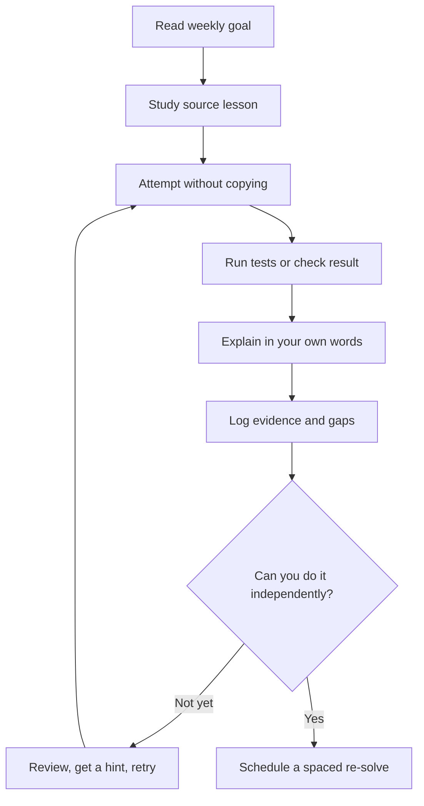

# Dojo

<div align="center">

**One repository. Deliberate practice. Evidence you can show.**

A 16-week, practice-first engineering programme combining Python and DSA interview preparation, Hugging Face-centred machine-learning study, an NSE market-insights project, and cloud/DevOps foundations.

[Start here](#start-here) · [Curriculum](#curriculum) · [Roadmap](ROADMAP.md) · [Daily protocol](docs/DAILY_PROTOCOL.md) · [Assessments](assessments/) · [Confidence matrix](CONFIDENCE-MATRIX.md)

</div>

---

Dojo is a learning system, not a promise that a fixed number of weeks makes someone job-ready. Build skills by attempting problems, implementing concepts, testing your work, recording what you learned, and collecting evidence of progress.

The current plan runs **26 October 2026 – 14 February 2027**. It is ambitious; adjust the daily workload to your circumstances, protect rest, and use the objective gates in [ROADMAP.md](ROADMAP.md) rather than rushing because a calendar says so.

## What you will practise

- **Problem solving:** DSA patterns, independent attempts, spaced re-solves, and timed practice.
- **Applied Python:** readable, tested Python for scripting, APIs, data work, and interviews.
- **Machine learning:** official Hugging Face material as the conceptual backbone, reinforced with small from-scratch implementations and experiments.
- **A real project:** an NSE market-insights platform, with attention to data quality, evaluation, sources, and limitations.
- **Cloud and delivery:** Linux, networking, containers, CI/CD, infrastructure as code, IAM, observability, and security.
- **Assessment practice:** timed mocks, written retrospectives, and evidence-based readiness gates.

## Start here

### 1. Prepare your environment

You need Python 3.10 or newer, Git, and a terminal. CI uses Python 3.12.

```bash
git clone https://github.com/Markkaruga254/dojo.git
cd dojo
python3 -m venv .venv
source .venv/bin/activate
python -m pip install --upgrade pip
python -m pip install -e ".[dev]"
```

On Windows, activate with `.venv\\Scripts\\activate`. This installs the importable NSE platform package in editable mode and the tools used by the core checks. Install optional lab dependencies only when needed with `python -m pip install -e ".[labs]"`. The repository contains intentionally incomplete teaching labs; installing dependencies does not mean every lab is complete or expected to pass.

### 2. Verify the core workflow

```bash
python -m ruff check scripts tests dsa/solutions
python -m pytest -q
PYTHONPATH=nse_platform/src python -m pytest -q nse_platform/tests
```

The final command sets the source path for the NSE tests. If a command fails, inspect the error and the relevant module instructions instead of skipping it.

### 3. Start learning

1. Read [ROADMAP.md](ROADMAP.md) and record your baseline.
2. Read [docs/PRINCIPLES.md](docs/PRINCIPLES.md) and [docs/DAILY_PROTOCOL.md](docs/DAILY_PROTOCOL.md).
3. Review [docs/TOOLS_SETUP.md](docs/TOOLS_SETUP.md) and [docs/HF_SYLLABUS_CHECK.md](docs/HF_SYLLABUS_CHECK.md).
4. Run `make day` to create today's log and `make week` to see the current focus.
5. Start with the first unfinished module in your scheduled track.

## Curriculum

| Track | Location | Practice and evidence |
|---|---|---|
| DSA and interview problem solving | [dsa/](dsa/) · [checkpoints](dsa/CHECKPOINTS.md) | Patterns, attempts, reference solutions, spaced re-solves |
| Applied Python | [python/](python/) · [checkpoints](python/CHECKPOINTS.md) | Test-backed practical Python labs |
| Machine learning | [ml/](ml/) · [checkpoints](ml/CHECKPOINTS.md) | Hugging Face study path plus tokenization and attention labs |
| NSE market-insights platform | [nse_platform/](nse_platform/) | Incremental product work, ingestion, evaluation, project evidence |
| Cloud and DevOps | [cloud/](cloud/) · [checkpoints](cloud/CHECKPOINTS.md) | Cloud engineering, delivery, infrastructure, security |
| Assessments | [assessments/](assessments/) | Interview banks, mock schedules, rubrics, timed practice playbook |
| Daily learning record | [log/](log/) | Daily notes, effort, outcomes, review |

### Learning loop



For ML, use **Hugging Face material → concept notes → small implementation → experiment/tests → reflection**. The selected chapter-to-lab plan is documented in [docs/HF_SYLLABUS_CHECK.md](docs/HF_SYLLABUS_CHECK.md). Verify current official unit availability and record your own completion evidence; a mapped unit is not automatically a completed unit.

## Daily system

1. **Attempt first.** Give the task a genuine independent attempt before using AI or reading a solution.
2. **Track honestly.** Record whether the result was independent, hinted, or assisted. Assisted completion is not independent mastery.
3. **Test and explain.** Capture the command, result, a small failure case, and an explanation.
4. **Review gaps.** Put missed DSA problems and unclear concepts into a retry queue.
5. **Close the day.** Complete the log, choose tomorrow's three priorities, and stop at the planned time.

See [the daily protocol](docs/DAILY_PROTOCOL.md). The tracker commands are `make day`, `make week`, and `make stats`.

## Prove progress

- Use the gates and mock rubrics in [ROADMAP.md](ROADMAP.md) and [assessments/](assessments/).
- Follow the [practical assessment playbook](assessments/PRACTICAL-ASSESSMENT-PLAYBOOK.md) before timed practice.
- Use the [capstone rubric](assessments/CAPSTONE-RUBRIC.md) to score a project using evidence and explicit critical-fail rules.
- Record attempts, outcomes, time taken, and whether hints were needed.
- Write a retrospective after each mock: what failed, why, and what changes next.
- Keep project evidence: tests, evaluation sets, architecture decisions, and a concise limitations write-up.
- Update the [confidence matrix](CONFIDENCE-MATRIX.md) with links to evidence, not confidence alone.

A green test suite only proves the tests that ran. It does not mean every course exercise is complete or guarantee interview readiness.

## Quality and known limitations

- CI checks completed Python modules and the core/NSE test suites. It does not treat unfinished ML starter exercises as completed implementations.
- Tokenizer and attention labs contain learning TODOs; completing them is part of the curriculum.
- The Hugging Face selected-unit map needs to be maintained against official source material; some external units may be unreleased or change.
- Optional labs may require extra dependencies. Install only what the selected lab documents.
- The NSE project is educational, not investment advice or a promise of accurate forecasts. Respect data-provider terms and document freshness, provenance, and model limitations.
- Cloud labs can incur charges. Check pricing, clean up resources, and never commit credentials or state files.

See [CONTRIBUTING.md](CONTRIBUTING.md), [the lesson template](docs/LESSON_TEMPLATE.md), and [the course audit](docs/COURSE_AUDIT.md) for contribution standards and improvement areas.

## Licensing

Check the repository's license files before reusing material. Third-party courses and external resources remain governed by their own terms; attribution does not imply affiliation or endorsement.
